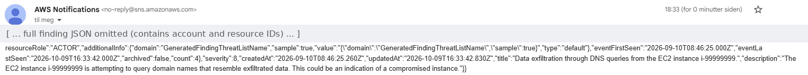

# AWS Threat Detection Baseline

[](https://github.com/adankhalid0/aws-threat-detection-baseline/actions/workflows/ci.yml)

A threat-detection and alerting setup for AWS — **GuardDuty** +
**Security Hub**, wired to a real notification pipeline with
**EventBridge** and **SNS**, deployed with **Terraform** and checked
on every push with **GitHub Actions**.

> Companion project to
> [aws-cloud-security-baseline](https://github.com/adankhalid0/aws-cloud-security-baseline).
> That project builds and audits secure configuration. This one answers a
> different question: if something actively goes wrong in the account,
> does anyone find out?

## Why this project

A well-configured, well-audited AWS account (the companion project) can
still be compromised — a leaked credential, a misused role, an S3 bucket
someone made public by accident despite every guardrail. Configuration
auditing catches drift from a known-good state; it doesn't catch an
attacker doing something the configuration never anticipated. That's what
detection is for.

This project:

1. **Enables** GuardDuty (managed threat detection) and Security Hub
   (continuous CIS 2.0 compliance monitoring + finding aggregation).
2. **Builds** an EventBridge → SNS pipeline so findings actually reach an
   inbox instead of sitting unread in a console.
3. **Tests** that the pipeline works end-to-end using GuardDuty's own
   supported sample-finding mechanism — no real attack simulation, no
   unnecessary risk to the account.
4. **Documents** what actually happened: timestamps, findings generated,
   whether and when the alert arrived.

See [`docs/PLAN.md`](docs/PLAN.md) for the full build plan, and
[`docs/DETECTION_FINDINGS.md`](docs/DETECTION_FINDINGS.md) for the
documented results of this specific run.

## Architecture

```
        ┌─────────────────────────────────────────────┐
        │                 AWS Account                   │
        │                                               │
        │   ┌────────────┐        ┌──────────────────┐  │
        │   │ GuardDuty  │        │  Security Hub     │  │
        │   │ (threat    │───────►│  (CIS 2.0 +       │  │
        │   │ detection) │findings│  finding          │  │
        │   └────────────┘        │  aggregation)     │  │
        │         │                └─────────┬─────────┘  │
        │         │ findings                  │ findings   │
        │         ▼                           ▼            │
        │   ┌─────────────────────────────────────────┐   │
        │   │            EventBridge rules              │   │
        │   │  (all GuardDuty · CRITICAL/HIGH SecHub)   │   │
        │   └───────────────────┬───────────────────────┘   │
        │                       ▼                            │
        │               ┌───────────────┐                    │
        │               │  SNS (KMS)    │──► email alert      │
        │               └───────────────┘                    │
        └─────────────────────────────────────────────┘
```

## What gets deployed

| Component | Purpose | Key details |
|-----------|---------|--------------|
| `modules/guardduty` | Managed threat detection | S3 data-event protection, 15-minute finding publishing frequency |
| `modules/security-hub` | Continuous compliance + finding aggregation | Subscribed to CIS AWS Foundations Benchmark 2.0 |
| `modules/alerting` | Findings → notification | EventBridge rules + KMS-encrypted SNS topic + email subscription |

## Tooling

- **Terraform** (>= 1.6) — Infrastructure as Code
- **Amazon GuardDuty** — managed threat detection
- **AWS Security Hub** — continuous compliance monitoring
- **Amazon EventBridge + SNS** — findings routing and alerting
- **Checkov** — static analysis of the Terraform code
- **GitHub Actions** — CI pipeline running `terraform fmt`, `terraform validate`, and Checkov on every push/PR

## Getting started

Full instructions with explanations: [`docs/PLAN.md`](docs/PLAN.md).
Quick version:

```bash
# 1. Fill in the backend block in terraform/environments/dev/versions.tf
#    with the state bucket/lock table from aws-cloud-security-baseline's
#    terraform/bootstrap (a different `key`, same backend infra).
cd terraform/environments/dev
cp terraform.tfvars.example terraform.tfvars   # edit with your values
terraform init
terraform plan
terraform apply

# 2. Scan the code with Checkov
cd ../../..
checkov -d terraform --config-file .checkov.yaml

# 3. Verify the alerting pipeline end-to-end
./scripts/simulate_findings.sh $(terraform -chdir=terraform/environments/dev output -raw guardduty_detector_id)

# 4. Check your inbox, then document what happened in
#    docs/DETECTION_FINDINGS.md
```

## Results

I ran the pipeline against a live AWS account in `eu-north-1` and generated
GuardDuty sample findings (462 findings appeared in the account).

- GuardDuty (with S3 protection) and Security Hub (CIS AWS Foundations
  Benchmark 2.0) were enabled by Terraform.
- **The first run did not deliver any alert emails.** A manual test message
  published to the SNS topic arrived, so SNS and the email subscription were
  fine. The problem was between EventBridge and SNS: the topic was encrypted
  with the AWS-managed key `alias/aws/sns`, whose key policy does not allow
  EventBridge to publish. The deliveries failed silently.
- **Fix:** a customer-managed KMS key whose policy allows
  `events.amazonaws.com`, used for the topic instead of the AWS-managed key.
- **After the fix**, the alert arrived. The timestamps inside the message show
  the finding being generated at `16:33:42Z` and the event sent at `16:33:47Z`,
  about five seconds, and the email was received in the same minute.



The screenshot is cropped: the full message is the raw finding JSON, which
contains account and resource IDs.

## Cleanup

```bash
cd terraform/environments/dev && terraform destroy
```

## Lessons learned

- **Encrypted topics need a key policy that includes EventBridge.** The
  AWS-managed SNS key cannot be used when EventBridge publishes to the topic.
  The failure is silent, so I found it by testing the topic directly and then
  looking at the encryption settings.
- **The default alert is raw JSON.** EventBridge sends the whole event to SNS.
  In a real setup I would add an input transformer to send a short, readable
  message.
- **Alert on severity, not on everything.** The GuardDuty rule sends every
  finding. That is fine for a small test account but would be noisy in a real
  one, where I would filter to medium severity and above.
- **Check where the emails land.** The SNS subscription confirmation ended up
  in the spam folder, so alerts can be missed in a private mailbox. A real
  setup would use a shared mailbox or a chat integration.
## License

MIT — see [LICENSE](LICENSE).
